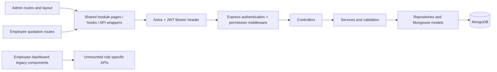

# WorkNest application architecture

Audit baseline: 2026-10-11. Decisions updated: 2026-10-15. The user approved the architectural direction and clarified D1–D8; the revised details/checklist below still require checkpoint approval before runtime changes. This update changes documentation only.

## Reading these contracts

- **Implemented** describes mounted routes and current source behavior; it does not imply browser/database verification.
- **Correction** identifies a defect in an existing contract.
- **Approved direction** records the user's clarified business/architecture decisions; it does not mean implemented or authorized to start before this checkpoint is approved.
- **Proposed detail** describes a specific choice needing this checkpoint's approval, particularly D6 retention and D7 pricing/draft boundaries.
- **Future / unresolved** is outside the current implementation or needs a business decision.

Read this document with [identity, permissions and ownership](roles-permissions.md), [API contracts](api-contracts.md), and [workflow and synchronization contracts](workflow-contracts.md). Source code remains the authority for implemented behavior.

The existing [authorization summary](../../AUTHORIZATION_SUMMARY.md), [quick reference](../../QUICK_REFERENCE.md), and [testing guide](../../TESTING_GUIDE.md) provide historical context. Their quotation endpoint inventory, employee submit permissions, navigation claims, and suggested role expansion are stale. Their test scenarios are instructions, not evidence of execution. These four documents supersede those claims for this checkpoint; no blanket rewrite of the older documentation is proposed.

## 1. Current system



| Concern | Implemented architecture | Sources |
|---|---|---|
| Frontend | React 19, React Router 7, Vite 6, Tailwind 4; JavaScript/JSX | [package.json](../../frontEnd/package.json), [main.jsx](../../frontEnd/src/main.jsx), [App.jsx](../../frontEnd/src/App.jsx) |
| Routing/layout | Separate Admin and Employee route groups; shared Sidebar; public login at `/` | [AdminRoutes](../../frontEnd/src/routes/AdminRoutes.jsx), [EmployeeRoutes](../../frontEnd/src/routes/EmployeeRoutes.jsx), [layouts](../../frontEnd/src/layouts) |
| State/fetching | Local React state and module hooks; localStorage session; no AuthContext or query cache | [permissions helpers](../../frontEnd/src/utils/permissions.js), [useTasks](../../frontEnd/src/modules/task/hooks/useTasks.js), [useQuotations](../../frontEnd/src/modules/quotation/hooks/useQuotations.js) |
| API client | Shared Axios instance attaches JWT, handles 401/403; some pages call it directly or use raw Axios | [axios.js](../../frontEnd/src/api/axios.js) |
| Backend | Express 5, CommonJS, module routes → controllers → services → repositories → models | [app.js](../../backEnd/src/app.js), [modules](../../backEnd/src/modules) |
| Database | MongoDB/Mongoose 8; User is also the Employee record; separate Quotation/QuotationItem collections | [User](../../backEnd/src/models/user.model.js), [Quotation](../../backEnd/src/modules/quotation/quotation.model.js), [QuotationItem](../../backEnd/src/modules/quotation/quotationItem.model.js) |
| Authorization | JWT user lookup, central role-permission map, permission middleware; quotation ownership in controller | [auth middleware](../../backEnd/src/middleware/auth.middleware.js), [rolePermissions](../../backEnd/src/utils/rolePermissions.js), [quotation controller](../../backEnd/src/modules/quotation/quotation.controller.js) |
| Errors | AppError status/message; global JSON `{message}` handler; no common malformed-ID/validation mapping or JSON 404 | [AppError](../../backEnd/src/utils/AppError.js), [app.js](../../backEnd/src/app.js) |
| Tests | Jest service/controller tests with repository mocks; quotation HTTP route tests with real JWT/middleware and mocked persistence | [tests](../../backEnd/tests/unit), [Jest config](../../backEnd/tests/jest.config.js) |

Only `backEnd/src/app.js` mounts business APIs. The older [backEnd/routes](../../backEnd/routes) and [backEnd/controllers](../../backEnd/controllers) are not an alternative live backend. Reconnecting them would restore incompatible models and contracts. There is no organization/tenant identity in the inspected models; `Customer.companyType` is a customer classification.

Other modules: Employees, Customers, Products, Orders and Dashboard have mounted APIs. Profile is a frontend localStorage view. Conversation has an unrouted frontend file and no mounted business API; it is not an integration target.

## 2. Admin versus Employee

The existing Admin pages are the UI reference and should be retained. Source inspection also found defects in shared/backend paths; “implemented” below does not certify live Admin behavior.

| Capability | Admin path | Employee path | Reuse / required correction |
|---|---|---|---|
| Session | Login stores JWT and user; Admin role guard | Same login, Employee role guard | Reuse JWT/login; initialize current session safely and handle inactive/archived users |
| Navigation | Sidebar links to `/admin/*` | Sidebar receives a role but ignores it; every link still goes to `/admin/*` | One role-aware, permission-aware navigation definition |
| Tasks | TaskManagement + useTasks + shared API; list/create/update/soft delete | Legacy dashboard widget calls unmounted `/api/employee/tasks/*`; offers deletion without permission | Retain Admin page; adapt shared hook/cards/table for assigned-task view and explicit status actions |
| Task ownership | All active tasks returned; populated assignee/assigner | `TASK_READ` currently allows the same unscoped list; `TASK_UPDATE` absent | Scope reads by assignment and enforce a status-only employee update before granting permission |
| Task details | Cards/modal; backend detail service exists but is not routed | No dedicated task route or working detail API | Add a small shared detail view/API using existing service |
| Task editing | Existing modal; populated assignedTo and ISO date are copied directly into form state | No compatible editor | Normalize assignee ID/date for Admin edits; employee uses status control, not the Admin full editor |
| Quotation list/create/edit/details | Shared current module, API wrappers, filters/pagination | Current `/employee/quotations*` routes reuse it; prior edit-route/submit-permission fixes are present | Preserve shared module and those fixes |
| Dashboard quotations | Current Admin quotation module exists separately | Dashboard still mounts EmployeeQuotationManagement with old fields and unmounted APIs | Retire dashboard legacy imports once shared replacements are ready |
| Quotation actions | Backend submit/approve/reject/reopen operations exist | Employee submit is allowed; details still show approve/reject without permission checks | Reuse operations; permission/status/ownership-aware actions and parent detail refetch |
| Quotation pricing | Backend calculates and stores snapshots/totals | Same backend/form; zero-GST and discount preview mismatch | Correct shared calculation/input/snapshot contracts; no new tax regime |
| Dashboard | Shared metrics endpoint consumed | Legacy composite dashboard uses old role-specific Customer/Task/Quotation/Order endpoints | Preserve Admin presentation; fix broken metric method and define scoped Employee summaries |
| Customer/Product selection | Current quotation selectors use shared catalog APIs | Same selectors, but quotation form also fetches admin-only Employee directory | Keep selectors; fetch employee directory only for authorized assignment UI |
| Profile | `/admin/profile`, reads incomplete login user | No `/employee/profile` route | Shared self-profile read via proposed current-user API |
| Orders | Shared list/status/archive/download wrappers | Legacy widget calls unmounted role-specific Order API; shared Order reads are unscoped | Ownership decision first; no Order rewrite or conversion implementation implied |

Primary sources: [TaskManagement](../../frontEnd/src/modules/task/pages/TaskManagement.jsx), [EmployeeTaskManagement](../../frontEnd/src/modules/task/pages/EmployeeTaskManagement.jsx), [EmployeeDashboard](../../frontEnd/src/modules/dashboard/EmployeeDashboard.jsx), [QuotationManagement](../../frontEnd/src/modules/quotation/pages/QuotationManagement.jsx), [WorkflowActions](../../frontEnd/src/modules/quotation/pages/quotationDetails/components/QuotationWorkflowActions.jsx).

## 3. Prioritized gaps

| Priority | Verified gap | Dependency / scope |
|---|---|---|
| P0 | User populations and employee-create responses can expose password hashes | First security group: safe projections/serialization; preserve password verification |
| P0 | Inactive/archived users can log in and retain API access | Reuse existing User status/deleted fields and JWT lookup |
| P0 | Employee Task reads are unscoped; Order/global metrics APIs lack safe Employee visibility rules | Before feature activation: assigned-task scope, deny Employee Order list/exports and global metrics under approved D3/D5 |
| P0 | Employee quotation update accepts a new employeeId; changed customer/assigned user references are insufficiently validated | Keep authoritative identity/ownership through mutations |
| P0 | Employee task actions use unmounted endpoints; granting TASK_UPDATE alone would expose Admin update fields | Shared status-only business rule and assignment checks must ship with permission |
| P0 | Quotation amounts differ across backend/preview; header/item writes can partially persist and status changes race | Calculation and persistence corrections in quotation stage; deployment transaction support must be verified |
| P1 | Sidebar/401/access-denied routes disagree; missing current-user/profile/task routes | Shared session and navigation stages |
| P1 | Quotation detail actions leave parent data stale; list mutations leave filter counts/membership stale | Refetch using existing hooks, pending/error states |
| P1 | Legacy Employee dashboard modules, unconditional employee-directory fetches, missing task detail API | Retire obsolete integrations incrementally |
| P1 | Auth registration role validator contradicts User enum and registration prehash plus model hook hashes twice | Shared auth correction, separate regression of Employee creation |
| P1 | Customer create API missing; Dashboard calls nonexistent quotation count method; Orders use obsolete quotation fields/export assumptions | CC-1 separately implements eventual Employee Customer creation; scoped Dashboard approved; Employee Orders deferred and backend access denied |
| P2 | Broad pre-existing lint cleanup, bundle splitting, removal of dormant legacy files, broader test infrastructure | No unrelated cleanup in integration stages |

The [API contracts](api-contracts.md) and [workflow contracts](workflow-contracts.md) provide exact conditions and limitations. No data migration is required for identity, scoping, navigation or employee task integration. Quotation transaction/index/schema changes need a separate concrete review.

## 4. Proposed minimum architecture

Keep one backend/database, existing JWT authentication and permission map. Controllers handle transport, services enforce actor/resource/state/input rules, repositories apply scoped queries and safe population projections. Frontend route visibility is a usability layer; every API independently enforces access.

Retain current `/admin/*` and `/employee/*` URLs and all current API envelopes. Future mobile clients use the same JWT, resource APIs and backend policies. A small shared session context can make current-user/permission initialization reactive without adding a library or replacing authentication.

Compatibility means retaining working Admin interfaces, permissions, route identifiers, body/envelope shapes and management behavior, including existing quotation archive eligibility. Denying unsafe Employee reads and inactive-user sessions is an intentional security correction. Proposed D6 retention preserves field names/types but changes reopen's rejection fields from cleared to retained; explicitly test/review that response semantic. D7 clarifies corrected calculated amounts without silently rewriting historical data.

```text
frontEnd/src/
  api/axios.js                         retain; correct session error handling
  modules/auth/
    pages/Login.jsx                    retain
    AuthContext.jsx                    proposed small session initializer
    services/auth.api.js               proposed wrapper for login/current user
  routes/{AdminRoutes,EmployeeRoutes}.jsx
  layouts/{AdminLayout,EmployeeLayout}.jsx
  shared/components/{Sidebar,ProtectedRoute}.jsx
  shared/navigation.js                 proposed shared route/menu metadata
  utils/permissions.js                 reuse, read initialized session consistently
  modules/task/
    pages/{TaskManagement,EmployeeTaskManagement}.jsx
    components/TaskDetails.jsx          proposed small shared detail view
    hooks/useTasks.js                   adapt fetching/actions by capability
    services/task.api.js                retain shared resource endpoints
  modules/quotation/                   retain pages/components/hooks/API wrappers
  modules/{customer,product,order,employee,dashboard,profile}/
                                      retain; approved integrations only

backEnd/src/
  app.js                               retain mounts/error convention
  middleware/{auth,permission}.middleware.js
  models/user.model.js                 retain single User/Employee identity
  utils/{permissions,rolePermissions}.js
  utils/resourceAccess.js              proposed small shared actor/scope helpers
  modules/{auth,task,quotation,...}/
    *.routes.js                        existing permission middleware
    *.controller.js                    pass authenticated actor, no trusted body identity
    *.service.js                       resource policy + workflow validation
    *.validation.js                    fill relevant existing validators
    *.repository.js                    scoped reads/writes, safe projections
    *.model.js                         retain existing entities/enums
backEnd/tests/unit/                    extend focused policy/workflow coverage
```

These new helper filenames are proposals, not mandated abstractions. Prefer extending an existing file when it keeps a change smaller. Do not create a second employee service stack, database permission engine, role, global state framework, or new mobile module.

### Routing and UI contract

| Route family | Implemented | Proposed |
|---|---|---|
| Public | `/` login; `/unauthorized`; no `/login` | Retain `/`; correct every session redirect; role-aware return from denied page |
| Admin | `/admin/dashboard`, employees, tasks, customers, products, quotations, add-quotation, quotation detail/edit, orders, profile | Retain addresses/layouts; permission checks on leaf pages/actions |
| Employee | `/employee/dashboard`, `/employee/quotation` create, `/employee/quotations`, detail/edit | Retain addresses; add tasks and task detail, profile; other modules only after approval |
| Optional Employee catalogs/orders | No current standalone routes | Shared catalog reads/quotation selection retained; optional standalone read pages. Customer Creation is required future CC-1 work, Product mutations stay Admin-only, Employee Orders deferred/denied under D3 |

Navigation must require both an implemented route and permission. A module READ permission does not make an Admin URL suitable for employees. The Sidebar must update when session permissions change. Resource details/forms handle 403/404 and locked status even when opened directly. Use existing SkeletonLoader, toast, filters and pagination; add explicit empty/error/retry states rather than silently displaying empty data after failure.

### File disposition

| Files / groups | Treatment after approval |
|---|---|
| `backEnd/src/app.js`, current module models/repositories/routes, JWT middleware/map | Retain; targeted auth, policy, validation and projection corrections |
| `frontEnd/src/routes/*`, `layouts/*`, `api/axios.js`, permission helpers, Sidebar, ProtectedRoute, Unauthorized | Refine session initialization, role-aware routes/actions and redirects |
| TaskManagement, TaskModal, TaskCard, TaskTable, useTasks, task.api; backend task module | Reuse Admin behavior; normalize edit fields, add detail and assignment/status policy |
| QuotationManagement, AddQuotation, QuotationDetails, WorkflowActions, useQuotations, quotation utilities/constants/API; backend quotation module | Reuse; correct verified ownership/calculation/snapshot/persistence/action/refetch defects in reviewable groups |
| EmployeeDashboard, EmployeeTaskManagement | Adapt composition/view to shared contracts; retain Employee experience without the obsolete API calls |
| EmployeeQuotationManagement, EmployeeOrderManagement | Replace mounted legacy usage with shared approved views; leave dormant files until replacements are verified |
| Profile, Customer/Product shared pages/hooks, Dashboard service | Read-self Profile and assigned-task/owned-quotation Dashboard approved; catalog reads retained, future Customer Creation scoped to CC-1; preserve Admin UI |
| `backEnd/routes/*`, `backEnd/controllers/*`, empty AuthRoutes, Conversation | Leave unmounted; no reconnecting or unrelated removal |
| Existing backend tests | Extend meaningful auth/scope/workflow tests; isolate unrelated Order PDF baseline failure |

## 5. Implementation order and review gates

This small ordered checklist supersedes the earlier broad stage plan. Each box is a reviewable group, not permission to run all groups unattended. Relevant tests and Admin/API regression checks run within each group; stop for review before the next group.

- [ ] **1. Stop hash exposure and inactive sessions.** Safe direct/populated User responses (including Employee POST, Task, Customer and detailed Order paths); reject inactive/deleted users at login and with existing JWTs. Test actual serialization and active Admin/Employee password verification; no role/schema/API redesign.
- [ ] **2. Enforce Employee resource boundaries.** Assigned-only Task reads; deny Employee Order list/PDF/CSV via central permissions and global dashboard metrics until scoped metrics exist; reject Employee quotation owner changes before existing writes and validate touched references. Test substituted IDs, stale browser permissions and two employees; preserve Admin permissions, envelopes and archive behavior. Do not grant TASK_UPDATE yet.
- [ ] **3. Align shared session and Employee navigation.** Add `/auth/me` and read-self Profile, reuse JWT/User identity, correct `/` expiration and denied-page navigation, use role-aware menus/guards. Correct registration enum/double hashing in a small adjacent auth group with Employee-creation regression. Preserve Admin and existing quotation URLs; no Profile writes.
- [ ] **4. Integrate assigned Employee Tasks.** Reuse shared Task APIs/hook/cards/table; add scoped detail, actor/assignee validation and approved `pending → in-progress → done`. Grant TASK_UPDATE only with status-only assignment/state enforcement. Admin retains reassignment/reopening/full management; normalize existing Admin edit payloads, and verify both-role refresh.
- [ ] **5. Verify D8, then complete shared Quotations in small groups.** Record topology capability and execute disposable transaction rollback tests before changing quotation persistence. Implement approved D6/D7 details after this checkpoint: latest-rejection retention/labels, one normalized GST/cent rule and complete-draft validation; fix permission-aware actions, directory fetch, list/detail refetch, snapshot integrity and saved-draft retries. Review persistence changes separately; no conversion, incomplete drafts or historical recalculation. If D8 cannot be verified, pause this persistence group and report the missing evidence.
- [ ] **6. Connect the approved Employee Dashboard.** Only assigned-task and owned-quotation summaries, using scoped queries and the shared metrics endpoint; retain Admin's four-field contract. Remove obsolete mounted widgets as shared sections become functional; no Employee Order/global statistics or unsupported Customer-create button. Customer Creation remains CC-1 rather than being silently discarded.
- [ ] **7. Verify integrated flows and Admin regression.** Execute focused automated checks and, when available, real test-database/browser assignment/status and submission/decision/refresh scenarios. Run relevant lint/build/tests, report known baseline failures separately, and distinguish unit/HTTP evidence from actual end-to-end verification.

**Separately scoped required issue:** [CC-1 — Customer Creation](roles-permissions.md#separately-scoped-issue-cc-1--customer-creation) will enable permitted Admin/Employee customer acquisition through the shared API. It needs its own concrete plan/review; no new Customer grant or runtime implementation is included above. Optional standalone read-only catalog pages need explicit scope selection. Employee Orders, Profile writes, incomplete drafts and Order conversion remain deferred. Product create/edit/archive remain Admin-only.

Stop for approval now, before checklist item 1. The [decision register](roles-permissions.md#6-approval-decisions) records approved direction versus details proposed for this checkpoint. If a prerequisite cannot be verified, report it rather than claiming later workflow completion.

## 6. Executed baseline and limits

Executed during the **2026-10-11 audit**; retained as dated baseline, not rerun during the 2026-10-15 documentation-only decision update:

| Check | Result |
|---|---|
| Backend: `node node_modules/jest/bin/jest.js --config tests/jest.config.js --runInBand --coverage=false --cache=false --silent` from backEnd | **93 passed, 1 failed; 14 suites passed, 1 failed.** Failure: Order service PDF mock, `generateOrderPdf.mockResolvedValue is not a function`, [order.service.test.js](../../backEnd/tests/unit/order.service.test.js) line 100 |
| Frontend: `npm run lint -- --format json --output-file /private/tmp/worknest-architecture-eslint.json` | **Failed: 30 errors, 6 warnings, 19 files with errors.** Existing unused variables, duplicate `cta` key and hook dependency warnings |
| Frontend: `npm run build -- --outDir <temporary directory>` | **Passed.** Existing duplicate `cta` key and large bundle warnings; output outside the repository |
| Isolated source/model probes, without DB | Confirmed unscoped Task query/service, missing User population projections, broken Dashboard quotation count method, calculation mismatches and permissive numeric coercion. Running the actual User pre-save hook on a service-prehashed sample confirmed the stored hash no longer matches the original password; no database write performed |

No runtime file changed in either documentation checkpoint. On 2026-10-15 the documentation links/consistency and unchanged runtime scope are checked; runtime tests/build/lint are not rerun for prose-only changes. No frontend test runner or TypeScript check is configured. The MongoMemoryServer setup files are not wired into the current Jest config; passing mocked tests do not prove database transactions/indexes/population compatibility. Repository inspection did not establish deployed transaction capability; see the [D8 gate](workflow-contracts.md#d8--transaction-verification-gate). No live database or browser end-to-end verification was performed.

Setup discrepancy: backend `dev` targets `src/server.js`, while `start` targets absent root `server.js`; backend `build` invokes react-scripts despite the actual frontend living in frontEnd/Vite. These are documented setup issues, outside the requested runtime checkpoint.
