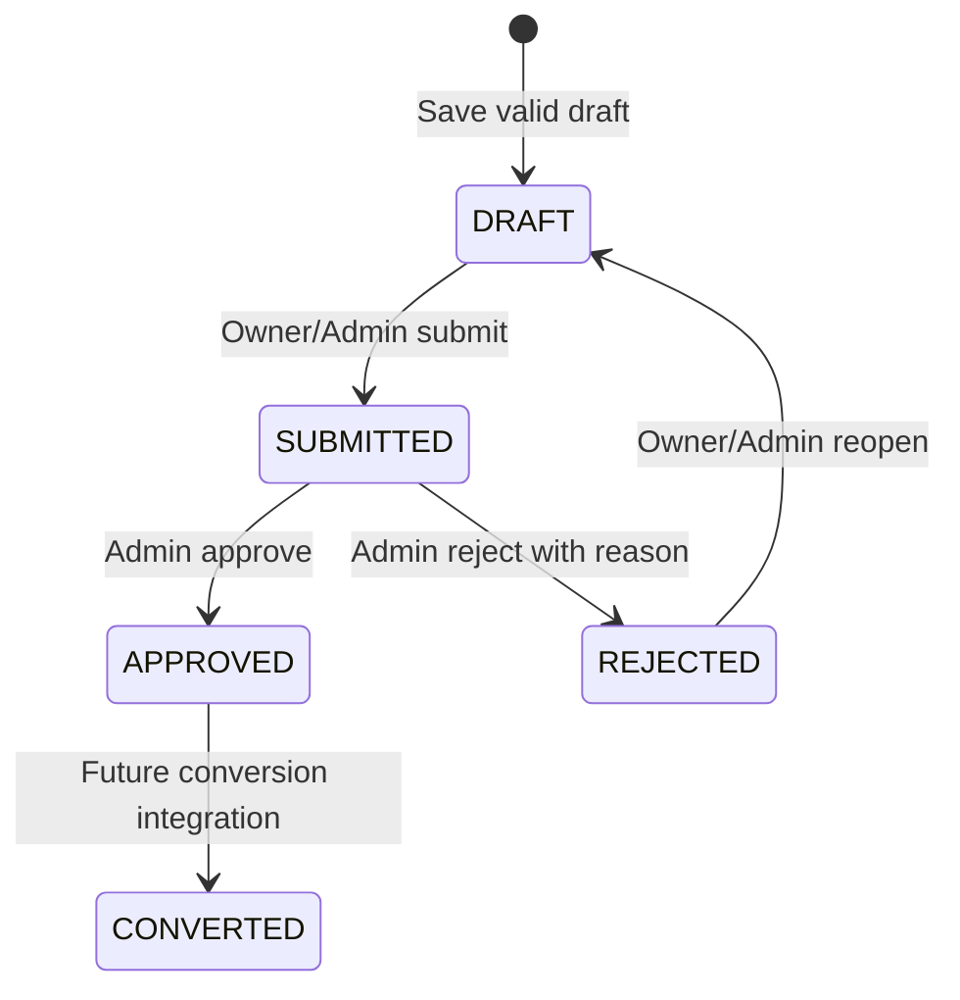

# WorkNest Admin ↔ Employee workflow contracts

Audit baseline: 2026-10-11. Decisions updated: 2026-10-15. Current behavior is separated from approved direction and proposed details. No runtime implementation is authorized until this revised checkpoint is approved. Review gates are in [application architecture](application-architecture.md); D1–D8 are in [roles-permissions](roles-permissions.md); transport details are in [api-contracts](api-contracts.md).

## 1. Task workflow

### Current implementation

Sources: [Task model](../../backEnd/src/modules/task/task.model.js), [service](../../backEnd/src/modules/task/task.service.js), [Admin TaskManagement](../../frontEnd/src/modules/task/pages/TaskManagement.jsx), [EmployeeTaskManagement](../../frontEnd/src/modules/task/pages/EmployeeTaskManagement.jsx), [useTasks](../../frontEnd/src/modules/task/hooks/useTasks.js).

- Admin can create, assign, edit, change status and soft-delete through mounted APIs. assignedBy currently comes from the body, and assignee existence/activity is not checked. Admin editor may send a populated assignee object and unnormalized ISO dueDate; source indicates a payload/form mismatch, requiring browser verification before calling the Admin edit flow correct.
- Status enum is exactly `pending`, `in-progress`, `done`. The service has no transition table; Admin can change any enum status to any other. Reassignment does not reset status.
- Employee has TASK_READ but the list is unscoped. Employee lacks TASK_UPDATE and TASK_DELETE. Its legacy dashboard widget calls unmounted endpoints and offers a cyclic `pending → in-progress → done → pending` interaction plus Delete; those are not functioning backend contracts.
- A getTaskById service exists, but no mounted GET detail endpoint. No comments/activity/history implementation exists.

### Approved target flow (D1; implementation pending checkpoint approval)

```mermaid
sequenceDiagram
    participant A as Admin
    participant API as Shared Task API
    participant E as Assigned Employee
    A->>API: Create task (validated assignee)
    API-->>A: Success; Admin list refetch
    E->>API: GET tasks / detail
    API-->>E: Assigned active records only
    E->>API: PUT task status
    API->>API: Permission + current assignment + field allowlist + transition
    API-->>E: Updated task; Employee refetch
    A->>API: Refresh task list/detail
    API-->>A: Current employee status
```

| Operation | Target actor / precondition | Result |
|---|---|---|
| Create | Admin TASK_CREATE; valid active employee assignee; required title/description/date; valid priority/status | Existing generated taskId; assignedBy derived from actor; pending by default |
| Read list/detail | TASK_READ; Admin broader view / Employee currently assigned; nondeleted | Same scope for list/detail/counts; safe populated users |
| Start | Assigned Employee TASK_UPDATE; `pending`; payload only status | `in-progress`; updatedAt advances |
| Complete | Assigned Employee TASK_UPDATE; `in-progress`; payload only status | `done`; updatedAt advances |
| Retry same status | Same authorized actor/assignment | Harmless no-op; no fabricated status changes |
| Reopen / other valid enum change | Admin TASK_UPDATE | Retain existing Admin transitions, including reopening; Employee backward/direct completion disallowed under approved D1 |
| Reassign | Admin TASK_UPDATE; valid assignee | Preserve status; previous employee loses read/update access, new employee receives task |
| Delete | Admin TASK_DELETE | Soft-delete; disappears from both views and rejects ordinary updates |

Only grant Employee TASK_UPDATE in the same change that enforces assignment and a status-only body. Reject attempts to change assignedTo, assignedBy, title, description, priority, dueDate or identity, including requests that combine a valid status with a forbidden field. Use an assignment/state-conditional write so a concurrent Admin reassignment cannot be bypassed by an earlier ownership read. Admin requests continue using their current permitted fields and envelopes.

No new Task audit/activity feature is required. Existing assignedBy records are not silently rewritten; define whether it remains the initial assigning actor if reassignment audit is later requested. D1 now approves the forward Employee transitions and Admin reassignment/reopening; it does not authorize copying the obsolete Employee cycle.

## 2. Quotation workflow

Sources: [Quotation model](../../backEnd/src/modules/quotation/quotation.model.js), [validator](../../backEnd/src/modules/quotation/quotation.validation.js), [service](../../backEnd/src/modules/quotation/quotation.service.js), [controller](../../backEnd/src/modules/quotation/quotation.controller.js), [AddQuotation](../../frontEnd/src/modules/quotation/pages/addQuotation/AddQuotation.jsx).



APPROVED → CONVERTED is in the status validator/model but has no active conversion operation. All other arrows have mounted endpoints. No EXPIRED state exists in the backend, despite a frontend constant; add consistent CONVERTED display and use canonical uppercase status keys.

| Operation | Current actor/permission and precondition | Current result / required correction |
|---|---|---|
| Create draft | Admin/Employee QUOTATION_CREATE; active customer, existing unique products, valid nonempty items | DRAFT; owner is Employee actor or Admin-selected user; creator from actor. Validate assigned user; preserve snapshots |
| Edit | Owner/Admin QUOTATION_UPDATE; DRAFT or REJECTED | Same Mongo identity/business number; replaces supplied items and updates audit fields. Prevent Employee owner changes, validate new customer, preserve existing snapshots |
| Submit | Owner/Admin QUOTATION_SUBMIT; DRAFT and stored items nonempty | SUBMITTED; normal editing locked. Revalidate stored references/pricing/validity before acceptance; no submittedBy/At fields currently |
| Approve | Admin QUOTATION_APPROVE; SUBMITTED | APPROVED; approvedBy/approvedAt stored, ordinary edits locked |
| Reject | Admin QUOTATION_REJECT; SUBMITTED and nonblank reason | REJECTED; reason/rejectedBy/rejectedAt stored |
| Revise / reopen | Owner/Admin QUOTATION_UPDATE; REJECTED | Edit is allowed while REJECTED; explicit reopen moves to DRAFT and clears last rejection fields; submit then moves to SUBMITTED |
| Archive | Admin QUOTATION_ARCHIVE; any state currently | Soft delete. Preserve current backend eligibility and UI availability; a DRAFT-only backend restriction is not approved |
| Convert | No mounted API | Separate Order work; actor/rules need separate approval |

The current edit form saves REJECTED edits, then calls reopen, and optionally submit as separate requests. D6 approves that state path. It does not approve destructive clearing as a retention policy or an archive restriction. Preserve the state path rather than inventing automatic generic status updates.

### D6 — Consequences and minimum retention proposal

**Current consequence:** reopening sets rejectionReason, rejectedBy and rejectedAt to null. These are the only stored rejection data, so the original reason, reviewer and time disappear from the record and API. Editing/resubmitting cannot recover them. A later rejection overwrites the same fields anyway; current storage cannot reconstruct multiple review cycles.

**Proposed detail for this checkpoint:** retain the existing three rejection fields on reopen, resubmission and later approval. Change them only when a new rejection is recorded. Use status to determine available actions, not the presence of a rejection reason. Display “Rejection” when status is REJECTED, and “Most recent rejection” with its actor/date when a later state still holds that historical event. QuotationCard/Table currently render any reason they find; update those labels along with details in the same change so DRAFT/SUBMITTED/APPROVED cannot look currently rejected.

This needs no new field, history collection or versioning feature. It preserves only the latest rejection; multiple rejection events and already-cleared history remain unavailable. Do not fabricate/backfill missing history. The field names/types, envelopes and workflow endpoints remain, but reopen changes from nulling these fields to retaining them: document and test that intentional response-semantic change before implementation, including any known API consumers. D8 verification must precede the affected quotation persistence change. If a consumer contract requires null-on-reopen, review a small additive latest-rejection snapshot instead of silently breaking that contract.

Admin/Employee list/detail share the current Quotation module and existing role-specific routes. The prior employee edit-route and QUOTATION_SUBMIT fixes are retained. Do not reconnect EmployeeDashboard's obsolete quotation implementation.

### Required correctness and UI corrections

1. Enforce permission, owner, editable status and reference rules in the service as well as scoped persistence. A body-supplied employeeId cannot transfer an Employee's quotation. Treat createdBy (actual creator) separately from employeeId (commercial owner); display accurate labels and handle missing legacy audit data.
2. Ordinary PUT cannot set status, quotation number or trusted totals. Protect SUBMITTED/APPROVED/CONVERTED from edits. Preserve existing Admin assignment and archive behavior; validate references and do not widen Employee rights.
3. Show Approve/Reject only with the respective permissions and SUBMITTED; Submit only with SUBMIT and DRAFT; Edit only with UPDATE and an authorized editable record. Display decision reason/actor/date and persisted line/header totals in read-only details. Do not label placeholder Convert/PDF actions as functioning operations.
4. WorkflowActions currently instantiates an unrelated list hook, so actions do not update parent details. Pass mutation callbacks/refetch from the owning page; action responses are headers without items. Refetch detail after success and refresh filtered lists/counts. Keep details visible with an inline error on failed refresh rather than replacing a complete record with a header.
5. Employee create/edit must not fetch the Admin-only Employee directory. Keep existing Customer/Product selectors and reusable API services. Inline customer-information edits are currently discarded; use supported read-only customer data until a separate edit/snapshot contract is approved.
6. Create-then-submit failure currently leaves a persisted draft without retaining its ID in the create form; retry can create another quote. Retain/route to the saved draft before retrying submit; pending controls prevent simultaneous clicks. Backend duplicate/concurrent operations need independent protection, not just disabled buttons.

## 3. State and persistence consistency

**Implemented:** status validators reject sequential invalid/repeated submit or approve requests. Backend service reads a document, checks state, then saves. Quotation header and individual items are written separately; update deletes old items before completing replacement. No transaction or conditional compare-and-set protects these writes.

**Correction/proposal:** status transitions must include expected state and authorized scope in an atomic write. Concurrent approve/reject, submit/edit or reassignment/edit must result in one valid persisted outcome; losing requests must fail consistently and reload current state. Repeated sequential transition behavior may retain current 400 rather than inventing an idempotent success response.

Persist header and items together, so failure never leaves an orphan header, missing item set or stale totals. D8 verification is a prerequisite to changing quotation persistence; no silent fallback that weakens the contract. No automatic historical recalculation/migration is proposed. If indexes are needed, audit existing duplicates before adding them.

### D8 — Transaction verification gate

**Repository inspection on 2026-10-15:** [server.js](../../backEnd/src/server.js) connects using the configured MONGO_URI but asserts no topology. No transaction/session use or checked-in replica-set/deployment configuration was found. [The memory-server fixture](../../backEnd/tests/setup/mongodb.js) uses standalone MongoMemoryServer and is not wired into the [Jest config](../../backEnd/tests/jest.config.js). Driver/Mongoose availability and mocked tests are not evidence of deployed transaction support. **Result: deployment support is unverified, not proven unsupported.** No live connection or transaction was attempted at this documentation checkpoint.

Before the quotation persistence group:

1. Inspect the intended environment with a read-only topology/capability command (`hello`) through its configured connection. Record server/version/session capability and replica-set membership or supported mongos topology; do not print credentials or the connection URI. Do not change deployment configuration during verification.
2. Verify actual transaction commit/rollback and header/item failure recovery against a disposable replica-set (or equivalent supported) test database. Do not use production business records for fixture writes or rollback tests. A topology check alone does not establish that the implementation works.
3. Record environment, sanitized capability evidence and executed tests. If standalone or unavailable, stop this persistence group and review a topology change or alternative; do not proceed with partial writes or a silent fallback.

Security containment does not depend on adding transactions: deny forbidden quotation owner changes before existing writes, scope reads and restrict unsafe APIs first. Single-document conditional writes have different requirements from multi-document transactions; they do not establish that the header/item persistence gate passed.

**Order readiness, not conversion implementation:** an approved quotation must retain its commercial snapshot and complete item set; Order currently has quotationId and snapshot fields but no active create/convert route, uniqueness constraint or full discount/GST item snapshot. A later conversion must check APPROVED, prevent duplicates, copy approved values rather than catalog values, and commit Order + CONVERTED state consistently. That integration is outside the Task/Employee quotation stage.

## 4. Quotation calculation and history contract

### Implemented conventions and reproduced defects

Backend [quotation.service](../../backEnd/src/modules/quotation/quotation.service.js) calculates each item as:

```text
base = quantity × unitPrice
discount = positive discountPercentage ? base × percentage / 100 : discountAmount
taxable = base − discount
gst = taxable × gstRate / 100
lineTotal = taxable + gst
```

GST is applied after the item discount. Header amounts aggregate item values; no separate quotation-level discount/tax input is applied. The service uses JavaScript Number and two-decimal rounding. Frontend [quotation.util](../../frontEnd/src/modules/quotation/quotation.util.js) ignores discountPercentage and substitutes 18 when gstRate is zero. Backend calculation defaults omitted GST to 0, while saved items/model default to 18. Header/line component rounding is inconsistent.

Executed isolated probes against current utilities (not DB/browser tests):

| Input | Backend | Frontend / inconsistency |
|---|---|---|
| 1 × 100, GST 0, no discount | Grand total 100 | Preview total 118 |
| 1 × 100, 10% discount, GST 18 | Grand total 106.20 | Preview total 118 |
| 1 × 0.05, 10% discount, GST 18 | Stored computed line total 0.05; header total 0.06 | Header differs from its line; discount/taxable rounding also disagree |
| unitPrice null; quantity true | Validator accepts null as 0 / true as 1 | Wrong input types not rejected |

Snapshots exist for productName/sku/description and unitPrice/discount/tax/line amounts. GET populates current Product too, but stored snapshot fields must remain authoritative. Ordinary edits currently enrich product names/descriptions again and require every product still to exist. Customer information is a live reference, not a historical customer snapshot; terms are represented only by notes. These limitations must not be presented as complete historical contract support.

### D7 — Approved pricing principle; proposed exact contract

One backend calculation is authoritative for both roles. Preserve item-level discount-before-GST, positive-percentage precedence, permitted price overrides, existing fields/envelopes and the absence of a second header-level discount. Frontend previews mirror the contract; saved detail pages show stored backend amounts.

**GST default proposal:** keep 18 as the existing compatibility default for a newly supplied item whose gstRate is omitted. Resolve it once at the backend boundary and use it for both calculation and stored item rate. Explicit 0 remains 0; null, blank, boolean and nonfinite values are invalid rather than defaulted. Forms send the displayed rate explicitly and permit correction per line. On an unchanged historical item, retain its stored GST rate rather than applying a new-item default. Product has no tax setting; this is an application default, not a statement that 18% applies to every sale. Do not infer a new rate from Customer companyType or modify saved approved amounts to match defaults.

**Money and rounding proposal:** use exact decimal parsing/scaled arithmetic and nonnegative half-up rounding to cents, with bounds checks before unsafe arithmetic. Existing monetary JSON fields remain numbers; no currency/decimal library or API format migration is proposed. Canonicalize new/editable unitPrice and amount discounts to two decimals at the backend boundary; report canonical values back. Do not impose an undocumented new two-decimal restriction on GST/discount percentages. If implementation requires additional precision/range limits for valid existing inputs, document and review those before introducing them.

```text
unitPriceCents = halfUpToCents(unitPrice)
baseCents = positiveIntegerQuantity × unitPriceCents
discountCents = positive discountPercentage
  ? halfUp(baseCents × exactPercentage / 100)
  : halfUpToCents(discountAmount or 0)
taxableCents = baseCents − discountCents
gstCents = halfUp(taxableCents × exactGstRate / 100)
lineTotalCents = taxableCents + gstCents
header component cents = sum of corresponding stored line component cents
```

Validate finite meaningful inputs, quantity >0 integer, price/discount >=0, rates/percentages 0..100 and effective discount <= base. Do not turn an absent/null price into a zero-priced item; explicit zero is valid under the existing contract. Use the effective percentage discount rather than subtracting both discounts. Example: 1 × 0.05, 10% discount, 18% GST yields base 0.05, discount 0.01, taxable 0.04, GST 0.01, line total 0.05; the one-line header must also be 0.05.

Preserve unchanged item snapshots even if the Product changes or is deleted; new items take new snapshots. Do not recalculate historical approved data or silently backfill previously inconsistent GST/amounts. Any historical repair is separate audited work. D8 must pass before the affected persistence implementation.

### D7 — Draft completeness proposal

**Current:** creation checks an existing active customer, requires an owner ID and at least one validated item, but does not validate the existence of an Admin-selected owner. Updates validate items when supplied; metadata-only updates bypass item validation, and changed-customer existence is not checked. Those edit/reference gaps are corrections, not intentional incomplete-draft support. The backend allows omitted validUntil; the existing form requires it. Notes are optional. There is no supported customerless, empty-item or partial-item draft flow.

**Recommended v1 boundary for checkpoint approval:** retain that commercial completeness requirement. Allow DRAFT to remain unsubmitted, but do not relax customer/item schema or persist placeholder products, quantities or prices. Preserve the existing API's optional validUntil and current Admin form's stricter requirement; supplied dates must be valid/future. Submission revalidates the complete stored quotation and a supplied validity date; an omitted API validity date does not acquire a new mandatory-field rule. No schema migration or new status is needed.

Incomplete-draft support is deferred, not rejected as a possible future feature. If later approved, separately specify optional customer/owner fields, empty items, incomplete row handling, validation at submit and total calculation for incomplete data. Relaxing the current form's validity requirement is also a separate explicit UI decision. Neither expansion is part of the initial security/Employee integration groups.

## 5. Data synchronization contract

Current hooks refetch on mount/filter changes. Task mutations trigger refetch, but the hook does not expose it and always fetches the Admin directory. Quotation mutations usually replace a list row without recalculating filtered membership/counts. Details have independent state; no cross-page query cache, polling or WebSocket exists.

Target behavior using existing hooks:

| Event | Immediate refresh | Other-role visibility |
|---|---|---|
| Admin creates/reassigns Task | Admin list/detail and affected summary refetch; no optimistic fabricated employee access | Employee refetch sees current assignment; prior assignee receives out-of-scope detail result |
| Employee updates Task status | Employee task detail/list refetch; pending state clears only after outcome is handled | Admin navigation/manual refresh/focus refetch sees persisted status |
| Employee creates/edits Quotation | Persist draft identity; refetch matching list/detail | Admin refetch sees canonical saved header/items |
| Employee submits Quotation | Detail + list/filter count + scoped summary refetch | Admin refetch shows SUBMITTED and review actions |
| Admin approves/rejects | Detail/list/count/summary refetch | Employee refetch shows decision and correct edit/action restrictions |
| Archive/deletion | Refetch lists/counts, clear or redirect affected details | Other role cannot continue reading/updating removed records |

D5 is approved: the Employee dashboard uses only assigned Tasks and owned Quotations. Proposed shared GET metrics response for Employee is `{pendingTasks,quotationsGiven}`: count nondeleted pending Tasks assignedTo = actor._id and all nondeleted Quotations employeeId = actor._id. It contains no global Product/Order totals. Admin keeps the existing four response keys. Apply scope before counting; until scoped metrics are implemented, backend denies Employee global-metrics access and the UI omits those unavailable cards rather than displaying fabricated zeroes.

D2 is a separate business path: future Employee customer acquisition → safe shared Customer creation (CC-1) → new customer available in existing quotation selection. Current shared customer reads are not a permanent prohibition on Employee creation. Product creation/edit/archive stays Admin-only. D3 defers every Employee Order view/export and requires backend denial until an ownership implementation is reviewed.

Expose refresh from existing hooks; owning pages trigger it after awaited mutations. Refetch on navigation and provide retry/manual refresh; focus refetch can keep two open role sessions reasonably current. Use request cancellation or ignore stale responses when filter/ID changes to avoid old fetches overwriting new state. Preserve existing search/filter/pagination rather than duplicate infrastructure. No promise of push updates or real-time synchronization is made.

Errors must not masquerade as successful empty lists or not-found records. Distinguish loading, empty, server/network error, forbidden and genuinely missing data. After a mutation succeeds but refetch fails, communicate the saved outcome and refresh failure separately; do not repeat create automatically.

## 6. Verification plan and executed evidence

### Executed baseline

The following are **2026-10-11 baseline results**, not tests rerun for the 2026-10-15 documentation update. See [architecture baseline](application-architecture.md#6-executed-baseline-and-limits) for commands: backend 93/94 tests pass, one Order PDF mock failure; frontend production build passes with existing warnings; whole frontend lint fails with 30 errors/6 warnings. Calculation, scope/Dashboard and actual User pre-save hashing probes were executed without DB.

[Quotation route tests](../../backEnd/tests/unit/quotation.routes.test.js) exercise actual HTTP routing, JWT authentication, permission middleware, controller and service with User/persistence mocks: own draft edit/submit, unauthenticated/other-owner denial, approval/rejection permissions, locked states, empty/repeated submission and rejected reopen/resubmit. These do not verify MongoDB transactions, real User registration hashing or browser navigation. Other current service/controller tests predominantly mock repositories; Task tests expect unscoped reads and must be extended for the proposed contract.

### Tests to add/run after each approved stage

| Area | Meaningful checks | Evidence needed |
|---|---|---|
| Auth/session | Admin/Employee login, inactive/deleted denial, expired/invalid JWT, malformed localStorage, current role/permission changes, registration single hashing, no password serialization | Backend HTTP/model checks plus frontend session/route checks; real DB hashing test before declaring registration fixed |
| Ownership | Two employees: own/other list/detail/update; substituted IDs/body identity; archived records; scoped pagination/counts; safe populated fields | Route/service tests plus real Mongo query/serialization checks |
| Task integration | Admin create/assign; assigned Employee detail/status; field/reassignment/delete denial; allowed/invalid transitions; duplicate status; reassignment racing update; Admin observes refresh | Both-role API workflow; actual browser/database flow separately |
| Quotation integration | Draft/create/edit keeps identity; item add/remove; submit→approve/reject; latest reason/actor/date retained through reopen/resubmit/approval with accurate labels; later rejection replaces latest event; Employee approval denial; locked records; repeat/concurrent requests; failed save/submit retry | Focused backend tests and shared frontend action/refetch checks; DB transaction failure tests; explicit reopen-response semantic compatibility review |
| Pricing/history | New-item omitted GST resolves to 18; explicit 0 retained; unchanged stored rate retained; percentage/amount precedence; exact half-up small-line rounding and summed headers; invalid/null/boolean/blank/negative inputs; excessive discount; missing refs; changed/deleted Product snapshots | Exact expected persisted amounts and line/header reconciliation; no historical recalculation; no tests merely repeating implementation |
| Draft boundary | Reject missing customer, empty items and partial invalid rows for v1; optional API validity remains optional; supplied invalid/expired validity rejected; explicit zero price handled distinctly from missing price | Backend validation/submit tests plus unchanged Admin form checks |
| Deferred unsafe reads / Dashboard | Employee Order list/PDF/CSV denied, including stale browser permissions; Employee global metrics denied until scoped response; two employees' counts remain separate; Admin response keys unchanged | Authenticated HTTP tests for every route and scoped repository-count tests |
| Navigation/UI | Every visible menu resolves to registered role-correct route; forbidden leaf/direct-ID actions; no Admin directory fetch for Employee; loading/error/empty/404; detail/list/count refresh | Targeted frontend tests or actual browser checks, reported honestly |
| Regression | Existing Admin Task editor/create/assign/delete; Admin quotation editor/review; Employee/User creation; customer/product selection; current envelopes | Existing suite + focused tests + frontend changed-file lint/build; no unrelated UI rewrite |
| Optional/separate modules | Customer/Product shared reads; CC-1 later creates a customer as Employee and selects it in a quotation; no Employee Product mutations or unapproved Order access | CC-1 tests run only in that separately scoped issue; no assumption that future Customer creation is already implemented |

### Required real integration scenarios

Use a test database with one Admin, two employees, a customer and products. Do not modify production records to establish evidence.

1. Admin logs in, creates/assigns Task to Employee A; A sees details, Employee B cannot fetch it; A updates permitted status; Admin refetches and sees it. Reassign to B and confirm A loses access.
2. Employee A creates a quotation, adds catalog items, saves and edits the same draft, checks stored monetary values, opens read-only details and submits. Admin refetches and approves; A refreshes and sees locked APPROVED details.
3. Repeat rejection path with recorded reason: A refreshes, revises, reopens and resubmits; invalid/arbitrary status updates and Employee approval/rejection fail.
4. Change Product name/price and remove a Product after a saved quotation; approved snapshot values remain unchanged. Exercise missing references, invalid input, repeat submission and injected persistence failure.

A future approved conversion test adds Order creation/duplicate prevention; it is not part of current executed evidence. No live browser/database integration was run at this documentation checkpoint. Stop for approval before runtime implementation.
## Implemented M4 Order workflow — 2026-10-17

This explicitly approved M4 delta supersedes the original deferred conversion statements; it does not re-enable Employee Orders or expand manufacturing/accounting.

```text
APPROVED quotation → exactly one confirm Order + CONVERTED quotation
pending → confirm → dispatched → delivered → closed
pending / confirm → cancelled (reason required)
```

Only Admin with ORDER_CREATE converts. Persisted quotation items/amounts are authoritative; no Product lookup/repricing supplies commercial values. Customer details are frozen from the linked Customer at conversion time, including existing archived Customers; missing Customer or inconsistent stored money requires explicit review. Original quotation identity/number, items, commercial values, creator, owner and approval remain unchanged. Order, counter and quotation status share the existing verified transaction helper. Actual failed-write rollback and concurrent/repeated conversion are covered by HTTP/replica-set tests.

The user approved preserving legacy duplicate/dangling Order links. The partial unique quotation index applies only to new server-marked conversions and includes archived ones. Every existing link, including unmarked/archived, blocks a new conversion. A valid active new conversion replays safely; archived/legacy inconsistencies require review. Historical missing discount/tax values remain unavailable; there is no silent migration/reconciliation.

Order status actions require Admin ORDER_UPDATE and current-state/version checks. The UI consumes backend `allowedTransitions` and sends `expectedStatus`; the backend remains authoritative. No backward/skipped transition or reopening is allowed. Cancellation requires a trimmed reason and records actor/date, and is allowed only from pending/confirm. Delivery and closure record dates. `closed` means administrative completion after delivery and does not record payment/revenue received. Unknown legacy statuses remain readable with no offered transitions. Existing Admin archive policy is preserved without a new status restriction.

Admin list, preview, details and PDF/CSV consume saved Order snapshots. Both roles continue sharing quotation records; Employee sees CONVERTED as read-only and remains denied all Order APIs/navigation under D3. Refetch/refresh provides synchronization without real-time infrastructure. Product hard deletion remains unchanged and cannot remove saved commercial snapshots. [M4 report](../development/order-integration.md) records exact APIs, deployment/index prerequisites, tests and remaining limits.
